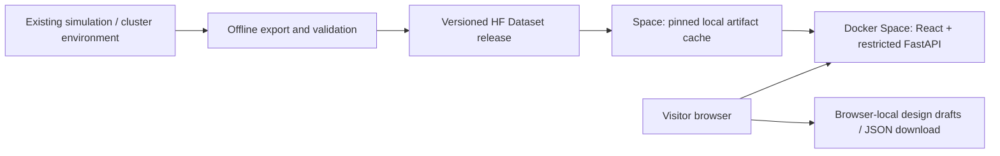

# Hugging Face Spaces: deployment and serving research

Researched on 27 October 2026. This is a deployment proposal; no application changes or deployment have been performed.

## Agreed first-release scope

Visitors can explore existing results and learn how to design experiments. They cannot execute experiments. Recommended interpretation: design edits belong to the visitor's browser, while published results and reference catalogs remain immutable. Saving a browser-local draft or downloading its JSON specification does not submit an experiment.

The assistant, live ML training, shared draft storage, catalog publishing, and simulation execution are outside the first release. Existing trained-model metrics can be presented as published data if available. Assistant support would be a separate decision because the current implementation adds conversations, provider configuration, model calls, and mutation tools.

## Recommendation

Use a **Docker Space with the existing React frontend and a restricted FastAPI backend**, on CPU Basic initially. Keep simulation generation in the current local/cluster environment. Publish a versioned, curated serving dataset to a separate Hugging Face Dataset repository.

At runtime, build the frontend into static files and serve it alongside `/api` on one origin. A single Uvicorn process can serve FastAPI plus the frontend assets on `0.0.0.0:7860`; register API routes before the SPA fallback, and ensure unknown `/api` routes return API errors rather than HTML. An Nginx proxy is an optional later optimization, not a first-release dependency.

Docker supports custom web applications and a configured public port. The existing frontend already uses relative `/api` URLs, so this topology preserves its API contract. See [Docker Spaces](https://huggingface.co/docs/hub/spaces-sdks-docker).

There is no job worker, simulation runner, Docker daemon, hosted LLM, or job queue in this Space. It needs no runtime write credential for the dataset. Public artifacts need no HF token; private artifacts would require a server-side read token and an explicit decision about what the public API may expose.

## Deployment alternatives

| Approach | Fit for this release | Main tradeoff | Assessment |
|---|---|---|---|
| Docker Space: React + FastAPI | Preserves existing search, reference, results and molecule APIs | Container startup; backend needs an explorer-specific configuration | Recommended first deployment |
| Static Space: React + precomputed JSON/Parquet assets | Excellent operational fit for immutable results and local design | Replace backend API behavior, indexing and result extraction with exported assets/browser logic | Strong later option, or first choice if zero compute hosting is the overriding requirement |
| Static Space + external API | Can reuse the backend on another host | Two deployments, cross-origin configuration, external uptime/cost | Prefer only if a suitable public API host already exists |
| Gradio rewrite | Useful for a small standalone scientific demo | Replaces the established React workflow without solving artifact access | No clear benefit for the existing application |
| All-in-one simulation Space | Could support limited live runs after significant runtime work | Long jobs, mutable state, storage growth, coupled UI/compute lifecycle | Outside the agreed scope |

Static Spaces support React build commands and have no running server. They are free to create and serve without a paid plan. This makes static delivery attractive, but it is not a drop-in deployment for an application that currently relies on FastAPI for data access. See [Static HTML Spaces](https://huggingface.co/docs/hub/spaces-sdks-static).

## What the repository establishes

| Evidence | Deployment implication |
|---|---|
| `interface/docker-compose.yml` has API, frontend, worker and runner services | The Space should package the web-serving subset, rather than copy the entire development topology |
| Frontend Dockerfile runs Vite dev server; backend Dockerfile uses Uvicorn `--reload` and installs dev dependencies | Create a production image with a Node build stage and a small Python runtime stage |
| `interface/frontend/src/api/client.ts` uses `BASE = '/api'` | Same-origin serving avoids a broad frontend endpoint migration |
| Backend requires Python >=3.11 and NumPy 2.4.6; simulation image uses Python 3.10.16 and NumPy 1.26.3 | Keep the backend and simulation environments separate; do not merge requirements |
| `table_reader_bridge.py` uses a standalone reader without importing the simulator | Results browsing can run without the compiled whole-cell runtime |
| Results and molecule APIs resolve `sim_dir` into local `simOut` paths | A DB snapshot alone cannot deliver the current detailed result experience |
| `hf_export` writes HDF5, metadata and manifests; cluster pruning produces `export/channels.h5` | Reuse these artifacts, but add a serving reader or offline conversion; the web reader is not already an HDF5 dataset browser |
| `results.py` generates mock timeseries if the real reader returns no data | Explorer mode must return explicit unavailable-data states, or explicitly labeled examples, instead of silent synthetic replacement |
| `builder_drafts.py` stores drafts in SQLite and `builder_publish.py` writes reconstruction files | The designer requires a local-draft adapter; disabling only Run does not make the app immutable |
| Assistant endpoints expose provider and runtime settings; experiment records have no visitor ownership field | Avoid shared writable state in an anonymous public explorer |
| `platform.py` exposes artifact-bootstrap settings as status metadata | Actual dataset download/bootstrap still needs implementation |

The simulation cost is further reason to separate publication from generation. `PLAN.md` records one four-generation job at 76 minutes, 2.03 GB peak RSS, and 2.8 GB raw output; pruning reduced that output to 129 MB. These are recorded cluster measurements, not benchmarks on Spaces. Older timing estimates in `RUN.md` are more optimistic.

## Serving data: publish once, read many times

Use a Dataset repository for finished scientific releases and provenance. Pin the Space to an exact dataset commit, not a moving `main` branch. A release should contain:

- A sanitized catalog/result index, as a SQLite snapshot or tables imported into a local SQLite database at build/startup. Include only data intended for publication; remove conversations, provider settings/secrets, logs and machine-specific paths.
- Summary metrics and modest, downsampled plot series for fast initial pages. Retain units, channel definitions, variant parameters, seeds, generations, termination states and source identifiers.
- Sharded detailed artifacts for molecule-level exploration, plus a manifest mapping each published job to the correct artifact and available channels/tensors.
- A schema version, simulator/source revision, dataset revision, checksums, export settings, and QC/availability records. Preserve scientific failure and lineage-termination information rather than treating every short trajectory as missing.

Prefer an adapter over the existing HDF5 export for detailed queries before introducing a new storage format. Measure how well it reads selected molecule columns. If a monolithic HDF5 file causes excessive downloads or cold reads, export independent run shards offline and cache the required shard locally before opening it with h5py. JSON summaries can serve common chart requests; Parquet is an option for tabular indexes and features. Choose the tensor format after measuring representative access, not by defaulting to a full format rewrite.

The current export's scalar-only default cannot supply every molecule view. Publish tensor availability in the manifest; either include the necessary tensors or mark that view unavailable for the affected run.

For a small initial release, bundle or download the catalog and a few representative run shards into the Space's disposable local cache. For a large archive, load additional shards on demand with bounded cache size, eviction, deduplicated downloads and capped response dimensions. Never read every tensor into memory or return a whole molecular matrix merely to draw a few selected molecules.

Ephemeral disk is acceptable here: every server-side file can be reconstructed from the pinned release. Use a separate explorer startup path so existing migrations, auto-recovery and reingestion do not rewrite a published snapshot on every boot. Build a compatible database offline, then open it read-only, or copy it to a disposable local database before strictly controlled initialization.

Storage Buckets are useful for mutable staging data and intermediate exports, while Dataset repositories provide versioned releases. Spaces can mount datasets read-only and buckets read-write. A bucket is unnecessary for the first release unless the archive workflow needs one. See [Spaces storage](https://huggingface.co/docs/hub/spaces-storage) and [Storage Buckets](https://huggingface.co/docs/hub/storage-buckets).

Do not put the current live SQLite WAL database on an object-storage mount. This is an engineering recommendation: the project's engine explicitly assumes local-filesystem WAL behavior, and bucket access uses network-backed mounts. Local disposable snapshots avoid that dependency. See `interface/backend/app/db/engine.py` and [bucket access patterns](https://huggingface.co/docs/hub/storage-buckets-access).

## Explorer behavior and enforcement

Introduce an explicit deployment profile, for example `DEPLOYMENT_MODE=explorer`, without changing the local simulation workflow.

| Capability | Explorer behavior |
|---|---|
| Catalog, network, pathways, genome, published results | Available through bounded read APIs |
| Design a single or batch experiment | Interactive input, validation and preview; browser-local draft; download specification |
| Preview new conditions/media/timelines | Local overlays or a stateless validation API; no published-catalog edits |
| Save experiments/drafts to the shared backend | Unavailable |
| Run/resume/reingest/cancel jobs; launch campaigns | Unavailable; direct API calls must also fail |
| Publish conditions or reconstruction edits | Unavailable |
| Train ML models | Unavailable; existing published metrics can remain readable |
| Assistant chat/provider settings/tool execution | Excluded initially |

Implement this as an explicit router/service capability policy, not just hidden buttons. Audit read routes for incidental writes too. Stateless validation can use POST if necessary; the important property is that it has no durable mutations or execution side effects. Local drafts must not appear as completed scientific experiments or acquire fake job IDs/results.

A public explorer needs no user account if all published data is public and personal drafts stay in the browser. Provide clear wording that drafts stay on this browser and an export option. Only introduce authentication if later requirements include private results or cross-device draft storage.

## Hardware and platform constraints

- CPU Basic currently provides 2 vCPU, 16 GB RAM and 50 GB ephemeral disk with no hourly hardware charge. It is the starting candidate for the restricted web service, subject to a dataset/query benchmark. CPU Upgrade is listed at $0.03/hour: approximately $21.60 for 720 running hours, excluding plan, storage and other charges. See [Spaces hardware](https://huggingface.co/docs/hub/spaces-gpus).
- Official overview docs currently say Docker/Gradio creation requires a paid plan; the Hub client guide further distinguishes subscribed CPU Basic from paid hardware with billing/credits. Verify the target account's eligibility before deployment. See [Spaces overview](https://huggingface.co/docs/hub/spaces-overview) and [Space management](https://huggingface.co/docs/huggingface_hub/main/guides/manage-spaces).
- Treat restarts and sleep as routine: cache loss must not lose results or drafts. Keep reconstruction inputs, simulator binaries and raw campaign outputs out of the serving image unless an actual read endpoint requires them.
- Run as UID 1000 with correctly owned writable cache directories. Use the production frontend build and omit developer credentials and `.env` files from the build context.
- Older permanent-disk instructions are stale: the current configuration reference marks `suggested_storage` ignored because that feature is no longer available. Use current dataset/bucket mechanisms where needed. See [Spaces configuration](https://huggingface.co/docs/hub/spaces-config-reference).

## Proposed implementation sequence and acceptance gates

1. **Inventory a representative public release.** Select real completed and terminated runs with different variants/conditions. Verify whether sources are raw `simOut`, pruned HDF5 or already exported data, total size, tensor coverage and publication permissions. Do not copy the entire local DB/output directory into the Space.
2. **Define the serving contract.** Specify manifest, stable result IDs, source mapping, units, provenance and missing-data behavior. Confirm one published run yields correct summary, timeseries and molecule values through the new adapter compared with the existing source reader.
3. **Implement explorer capabilities and local drafts.** Disable every execution and shared-mutation path at the API boundary. Exercise the designer without server persistence. Confirm direct API calls and assistant/tool routes cannot enqueue work or edit reference data.
4. **Build the production web image.** Node build stage; Python backend stage; static assets and `/api` on port 7860; separate explorer lifespan; pinned artifact bootstrap and bounded cache. Keep the existing local Compose simulation workflow intact.
5. **Benchmark and validate locally.** Check cold startup, peak RSS, disk/cache growth, catalog search, result comparison and molecule queries. Test direct SPA links, empty/missing artifacts, checksum failures, restart recovery, browser draft isolation and JSON export. Check published values against source artifacts; ensure no synthetic fallback reaches real result views.
6. **Deploy a small release and test in Spaces.** Verify CPU Basic capacity, iframe/browser behavior, cold-cache recovery, read API limits and complete absence of simulation processes. Publish a new dataset revision and redeploy to validate the release/rollback procedure.

The first concrete spike should be **one curated real result rendered through a compact artifact adapter, alongside the designer using browser-local drafts**. This resolves the largest uncertainty—compatibility of archived results with the current UI—before broad packaging work.

## Future live execution, if requested later

Keep a future executor interface separate from artifact reads. Hugging Face Jobs can run the existing simulation image independently of the Space, with status/log APIs and explicit timeout configuration. A default 30-minute job timeout would be too short for many recorded runs. See [Jobs overview](https://huggingface.co/docs/hub/jobs-overview) and [Jobs configuration](https://huggingface.co/docs/hub/jobs-configuration).

That phase would require durable per-user state, quotas, submission idempotency, cancellation/reconciliation and artifact publication. The current worker uses a local Unix socket and shared SQLite/filesystem, so HF Jobs is an execution-adapter project rather than an environment-variable switch. None of this is required for the agreed first release.

## Decisions still to resolve

- Which existing result collection should be public, and how large is it after export?
- Must the first release expose all molecule tensors or a curated subset?
- Is browser-local draft saving plus JSON export sufficient? This proposal assumes yes.
- Is the assistant absent for this release? This proposal assumes yes.
- Which Hugging Face account/organization and plan will host the Space and dataset?

No build, runtime benchmark, remote account check or deployment was performed during this research. Platform details above were checked against official documentation; capacity and data compatibility remain validation work.
